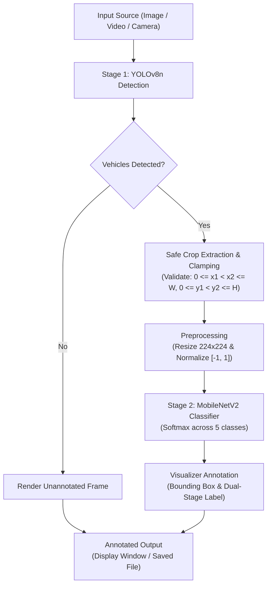

# Real-Time Two-Stage Vehicle Detection and Classification

A robust, modular computer vision pipeline combining **Ultralytics YOLOv8n** for fast object localization with a custom fine-tuned **MobileNetV2** convolutional neural network for fine-grained 5-class vehicle classification.

---

## 1. Project Overview

Standard object detection models (such as YOLO pretrained on the COCO dataset) can detect generic vehicles (cars, buses, trucks, motorcycles), but they cannot distinguish region-specific or specialized transit categories like **Three Wheelers** (auto-rickshaws).

This project implements a **two-stage prediction pipeline**:
1. **Stage 1 (Localization):** Ultralytics YOLOv8n detects vehicles in the frame at high speed and outputs bounding box coordinates.
2. **Stage 2 (Fine-Grained Classification):** Each detected vehicle bounding box is safely cropped, normalized, and classified by a transfer-learned MobileNetV2 model into five target classes:
   - **Bus**
   - **Car**
   - **Three Wheeler**
   - **Truck**
   - **Motorcycle**

By decoupling localization from fine-grained classification, the system achieves specialized vehicle identification while retaining real-time inference speeds across images, recorded video files, and live camera streams.

---

## 2. Project Features

- **High-Speed Vehicle Localization:** YOLOv8n detector with configurable confidence thresholds and COCO vehicle class filtering (`car`, `motorcycle`, `bus`, `truck`).
- **Fine-Grained Classification:** Custom MobileNetV2 architecture fine-tuned via two-stage transfer learning with balanced class weighting.
- **Unified Inference Engine:** A single `InferenceRunner` orchestrates frame-level predictions across:
  - **Static Images** (`scripts/predict_image.py`)
  - **Video Files** (`scripts/predict_video.py`)
  - **Live Camera Streams** (`scripts/live_camera.py` and `live_camera.py`)
- **Boundary-Safe Visualization:** Non-destructive bounding box renderer that automatically repositions labels when vehicles approach the upper frame boundaries to prevent clipped text.
- **Guaranteed Resource Management:** Robust `try ... finally` release guarantees for OpenCV capture devices, video writers, and GUI windows.
- **Centralized Configuration:** YAML configuration validated at runtime via Pydantic schemas.
- **Modular Training & Evaluation:** Standalone CLI tools for reproducible training (`scripts/train.py`) and validation evaluation (`scripts/evaluate.py`) with confusion matrix heatmap generation.
- **Automated Test Suite:** 42 unit and integration tests (Pytest) ensuring regression immunity.

---

## 3. System Architecture



### Architectural Pipeline Flow
1. **Input Ingestion:** BGR frames are captured from camera streams, decoded from video containers, or loaded from image files.
2. **Vehicle Detection:** YOLOv8n detects bounding boxes corresponding to vehicle classes (COCO IDs 2, 3, 5, 7).
3. **Safe Crop Extraction:** Box coordinates are clamped to the exact frame boundaries. Degenerate or empty crops ($x_2 \le x_1$ or $y_2 \le y_1$) are safely skipped.
4. **Image Preprocessing:** Vehicle crops are resized to $224 \times 224$ and normalized to the $[-1, 1]$ interval via MobileNetV2 preprocessing.
5. **Fine-Grained Prediction:** MobileNetV2 predicts class probabilities across the 5 target classes (`Bus`, `Car`, `Three Wheeler`, `Truck`, `motorcycle`).
6. **Annotation & Output:** The visualizer renders bounding boxes `(0, 255, 0)` and formatted labels (`<class>: <confidence>`). Output frames are displayed or saved to disk.

---

## 4. Technology Stack

- **Language & Runtime:** Python 3.12 (tested on Python 3.12.6 Windows)
- **Deep Learning Frameworks:**
  - TensorFlow 2.21.0 / Keras 3.14.1 (MobileNetV2 classification)
  - PyTorch 2.12.0 / Torchvision 0.27.0 (YOLO runtime backend)
- **Object Detection:** Ultralytics YOLOv8 (8.4.62)
- **Computer Vision & Image Processing:** OpenCV (`opencv-python` 4.13.0), Pillow 12.2.0
- **Numerical & Scientific Operations:** NumPy 2.4.6, SciPy 1.17.1, Pandas 3.1.1
- **Configuration & Validation:** Pydantic 2.14.3, PyYAML 6.0.3
- **Model Evaluation & Visualization:** Scikit-Learn 1.9.1, Seaborn 0.13.2, Matplotlib 3.10.9
- **Automated Testing:** Pytest 9.2.0

---

## 5. Project Structure

```text
Vehicle-type-classification/
├── README.md                           # Master project documentation
├── requirements.txt                    # Pinned project dependencies (UTF-8)
├── live_camera.py                      # Root convenience entry point (delegates to InferenceRunner)
├── yolov8n.pt                          # Pretrained YOLOv8 nano model weights
│
├── configs/
│   └── config.yaml                     # Centralized YAML master configuration
│
├── artifacts/
│   ├── class_indices.json              # 5-class target mapping
│   └── config.json                     # Training metadata artifact from data preparation
│
├── models/
│   ├── vehicle_classifier_best.keras   # Best trained MobileNetV2 checkpoint
│   └── vehicle_mobilenetv2_stage2.keras# Final Stage 2 fine-tuning checkpoint
│
├── data/                               # Dataset storage (local / gitignored)
│   ├── classification-dataset/         # Official 5-class vehicle dataset
│   ├── numberplate-dataset/            # Auxiliary number plate dataset
│   └── test-video/                     # Sample traffic test footage (.mp4)
│
├── notebooks/                          # Research & experimental Jupyter notebooks
│   ├── README.md                       # Guide to experimental notebooks
│   ├── 01_data_understanding_eda.ipynb # EDA and class distribution analysis
│   ├── 02_data_loading_preprocessing.ipynb # Metadata and artifact preparation
│   ├── 03_model_training.ipynb         # Two-stage transfer learning experiments
│   ├── 04_evaluation.ipynb             # Confusion matrix & performance analysis
│   ├── 05_test_vehicle_cropping.ipynb  # Bounding box crop extraction tests
│   ├── 06_test_classifier_on_crop.ipynb# Classifier validation on crop images
│   └── yolo.ipynb                      # Standalone YOLO detection experiment
│
├── outputs/                            # Generated runtime outputs (gitignored)
│   ├── crops/                          # Extracted vehicle crops
│   ├── evaluation/                     # Confusion matrix heatmap & metrics JSON
│   ├── logs/                           # Application runtime log files (app.log)
│   └── predictions/                    # Annotated test images and video files
│
├── scripts/                            # Operational CLI entry points
│   ├── train.py                        # Two-stage model training CLI
│   ├── evaluate.py                     # Model evaluation CLI
│   ├── predict_image.py                # Single image inference CLI
│   ├── predict_video.py                # Video file inference CLI
│   ├── live_camera.py                  # Live camera inference CLI
│   └── verify_phase1.py ... verify_phase5.py # Automated phase verification suites
│
├── src/                                # Core modular application package
│   ├── classifier.py                   # Compatibility bridge -> src.models.classifier
│   ├── data_loader.py                  # Compatibility bridge -> src.data.data_loader
│   ├── detector.py                     # Compatibility bridge -> src.models.detector
│   ├── config/                         # Configuration loader & Pydantic schema
│   ├── data/                           # Image preprocessing, augmentations, & data loaders
│   ├── evaluation/                     # Evaluator module (metrics & confusion matrix)
│   ├── inference/                      # InferenceRunner & Visualizer
│   ├── models/                         # MobileNetV2 architecture & model wrappers
│   ├── pipeline/                       # End-to-end two-stage prediction pipeline
│   ├── training/                       # Two-stage trainer with class balancing
│   └── utils/                          # CWD-independent path helpers & logger
│
└── tests/                              # Automated Pytest suite (42 tests)
```

### Compatibility Bridge Modules
The root modules `src/data_loader.py`, `src/detector.py`, `src/classifier.py`, and `live_camera.py` are **deliberately retained as backward-compatibility bridges**:
- `src/data_loader.py` allows existing notebooks (`03_model_training.ipynb`, `04_evaluation.ipynb`) to import `create_generators` without breaking.
- `src/detector.py` allows `05_test_vehicle_cropping.ipynb` and `yolo.ipynb` to import `VehicleDetector`.
- `src/classifier.py` provides a clean top-level import for `VehicleClassifier`.
- Root `live_camera.py` preserves the direct command `python live_camera.py` while delegating to the modular `InferenceRunner`.

---

## 6. Installation and Setup

### Prerequisites
- Operating System: Windows 10/11 (or Linux/macOS)
- Python Version: **Python 3.12** (tested on Python 3.12.6)

### Step-by-Step Setup (PowerShell)

1. **Clone the repository:**
   ```powershell
   git clone https://github.com/<your-username>/Vehicle-type-classification.git
   cd Vehicle-type-classification
   ```

2. **Create and activate a virtual environment:**
   ```powershell
   python -m venv venv
   .\venv\Scripts\Activate.ps1
   ```

3. **Upgrade pip and install dependencies:**
   ```powershell
   python -m pip install --upgrade pip
   pip install -r requirements.txt
   ```

4. **Verify the environment installation:**
   ```powershell
   python -m pytest tests/ -v
   ```

---

## 7. Dataset Setup

The official vehicle classification dataset contains **5 classes** and is stored under `data/classification-dataset/`:

```text
data/
└── classification-dataset/
    ├── Bus/            # Bus images
    ├── Car/            # Car images
    ├── motorcycle/     # Motorcycle images
    ├── Three Wheeler/  # Auto-rickshaw images
    └── Truck/          # Truck images
```

> [!IMPORTANT]
> Raw dataset images are excluded from Git version control via `.gitIgnore`. Users must supply their dataset locally in the directory structure shown above.

*Note on legacy `Dataset/`: An older, uncurated `Dataset/` folder containing only 4 classes (lacking Three Wheeler) may exist locally. It is deprecated and ignored; always use `data/classification-dataset/`.*

---

## 8. Model Files

The project relies on two sets of model weights:

| Model | Path | Description |
| :--- | :--- | :--- |
| **YOLOv8n** | `yolov8n.pt` | Ultralytics nano model for vehicle bounding box localization |
| **MobileNetV2** | `models/vehicle_classifier_best.keras` | Checkpoint with best validation loss from two-stage transfer learning |
| **MobileNetV2 Stage 2** | `models/vehicle_mobilenetv2_stage2.keras` | Checkpoint saved at completion of Stage 2 fine-tuning |

Both models are tracked in the repository or placed in their respective locations prior to running inference.

---

## 9. Model Training

To train the MobileNetV2 classifier from scratch or fine-tune it on the 5-class dataset, use `scripts/train.py`:

```powershell
# Validate architecture and data loading without fitting (dry-run)
python scripts/train.py --dry-run

# Run full two-stage training with custom epochs
python scripts/train.py --stage1-epochs 10 --stage2-epochs 20
```

### Supported Training Arguments:
- `--config CONFIG`: Path to custom YAML configuration (defaults to `configs/config.yaml`).
- `--stage1-epochs INT`: Epochs for Stage 1 (frozen base model, learning rate $10^{-4}$).
- `--stage2-epochs INT`: Epochs for Stage 2 (unfreezing top 30 layers, learning rate $10^{-5}$).
- `--checkpoint-dir DIR`: Directory to store `.keras` checkpoints.
- `--dry-run`: Builds and compiles both stages without fitting, ensuring fast validation of pipeline setup.

Training automatically computes balanced class weights via Scikit-Learn to counteract dataset imbalances and applies EarlyStopping, ModelCheckpoint, and ReduceLROnPlateau callbacks.

---

## 10. Model Evaluation

To evaluate a trained checkpoint on the validation dataset:

```powershell
python scripts/evaluate.py --model-path models/vehicle_classifier_best.keras --output-dir outputs/evaluation
```

### Generated Evaluation Artifacts:
- **Metrics Summary (`outputs/evaluation/metrics.json`):** Validation accuracy, precision, recall, and F1-score across all 5 classes.
- **Confusion Matrix Plot (`outputs/evaluation/confusion_matrix.png`):** A high-resolution Seaborn heatmap showing true vs. predicted vehicle categories.

---

## 11. Inference

### A. Static Image Inference
Run two-stage detection and classification on a single image file:

```powershell
# Predict and save annotated output
python scripts/predict_image.py --input data/classification-dataset/Car/Image_1.jpg --output outputs/predictions/car_pred.jpg

# Predict and display in an interactive OpenCV window
python scripts/predict_image.py --input data/classification-dataset/Car/Image_1.jpg --show
```

### B. Video File Inference
Process recorded video footage frame-by-frame:

```powershell
# Process up to 100 frames and display real-time preview
python scripts/predict_video.py --input data/test-video/5638-183850414_medium.mp4 --output outputs/predictions/annotated_video.mp4 --max-frames 100 --show-preview
```

### C. Live Camera Feed
Stream directly from a connected USB camera or webcam:

```powershell
# Run using the configurable CLI script
python scripts/live_camera.py --camera-index 1 --width 1920 --height 1080

# Or run via the root convenience shortcut
python live_camera.py
```

*Controls during camera/video preview:*
- Press **`q`** or **`ESC`** to terminate the stream safely.

---

## 12. Testing & Verification

The project includes an automated test suite implemented with Pytest:

```powershell
# Run the complete test suite (42 tests)
python -m pytest tests/ -v
```

### What the Tests Protect:
- **Architecture Integrity:** Validates that MobileNetV2 matches the exact layer topology, unfreezing logic, and output shapes.
- **Detector Clamping:** Ensures bounding box coordinates never exceed frame dimensions and handles empty frames gracefully.
- **Safe Crop Handling:** Guarantees that degenerate bounding boxes are skipped without raising runtime exceptions.
- **Inference Lifecycle:** Validates that models are loaded only once upon initialization and preserved across frames.
- **Visualizer Safety:** Asserts that drawing bounding boxes does not mutate prediction dataclasses and repositions labels safely near frame edges.
- **Backward Compatibility:** Verifies that legacy imports (`src.data_loader`, `src.detector`, `src.classifier`, `src.utils.draw_detection`) remain fully functional.

### Phase Regression Harnesses
To run the end-to-end integration verifications established during refactoring:
```powershell
python scripts/verify_phase1.py  # Configuration & Logging
python scripts/verify_phase2.py  # Preprocessing & Data Loading
python scripts/verify_phase3.py  # Model Wrappers & Prediction Pipeline
python scripts/verify_phase4.py  # Architecture, Trainer, & Evaluator
python scripts/verify_phase5.py  # InferenceRunner, Visualizer, & Camera Fallback
```

---

## 13. Configuration Management

All runtime parameters are centralized in [configs/config.yaml](file:///c:/Users/Nidula/Documents/Projects/Vehicle-type-classification/configs/config.yaml) and validated by Pydantic schemas in `src/config/schema.py`:

```yaml
project:
  name: "vehicle-type-classification"
  version: "1.0.0"

paths:
  artifacts_dir: "artifacts"
  models_dir: "models"
  data_dir: "data"
  outputs_dir: "outputs"
  class_indices_path: "artifacts/class_indices.json"

data:
  dataset_dir: "data/classification-dataset"
  image_height: 224
  image_width: 224
  batch_size: 32
  validation_split: 0.2

detector:
  model_path: "yolov8n.pt"
  confidence_threshold: 0.4
  vehicle_classes:
    2: "car"
    3: "motorcycle"
    5: "bus"
    7: "truck"

classifier:
  model_path: "models/vehicle_classifier_best.keras"
  input_height: 224
  input_width: 224
  num_classes: 5
  class_names: ["Bus", "Car", "Three Wheeler", "Truck", "motorcycle"]

training:
  stage1: { epochs: 10, learning_rate: 0.0001, early_stopping_patience: 5 }
  stage2: { epochs: 20, learning_rate: 0.00001, unfreeze_last_n_layers: 30, early_stopping_patience: 5 }

inference:
  camera_index: 1  # Automatically falls back to index 0 if unavailable
  frame_width: 1920
  frame_height: 1080
  window_name: "Real-Time Vehicle Classification"
  fullscreen: true

logging:
  level: "INFO"
  log_to_file: true
  log_file: "outputs/logs/app.log"
```

---

## 14. Project Limitations

1. **Native Windows GPU Support:** On native Windows installations, TensorFlow $\ge 2.11$ operates on CPU only unless configured via WSL2 or DirectML.
2. **Frame-by-Frame Processing:** The pipeline performs per-frame detection and classification without multi-object temporal tracking (e.g., DeepSORT or ByteTrack).
3. **Camera Device Hardware:** Camera index selection depends on hardware enumeration. The runner attempts camera index 1 first and automatically falls back to index 0 if index 1 cannot be opened.
